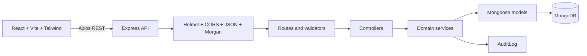

# System Architecture

## Overview

The system is a layered MERN application. The React client calls versioned REST endpoints through Axios. Express owns request parsing, security middleware, routing, validation, controllers, and centralized error responses. Services will own transactional workflows; Mongoose models own schema validation and indexes.

## Responsibilities

| Layer | Responsibility |
| --- | --- |
| `frontend/src` | UI foundation, routing, layouts, and API client |
| `backend/routes` | HTTP paths and request-to-controller mapping |
| `backend/controllers` | HTTP concerns and response formatting |
| `backend/services` | Multi-document workflows and transactions |
| `backend/models` | Mongoose schemas, validation, references, and indexes |
| `backend/middleware` | Cross-cutting request/error handling |
| `backend/config` | Environment and database connection |
| `backend/seeders` | Repeatable synthetic development data |

## Operational decisions

- Configuration is loaded from environment variables; credentials are never hardcoded.
- `helmet`, CORS, JSON parsing, and request logging are enabled centrally.
- Errors use one JSON error handler. Production responses omit stack traces.
- MongoDB unique indexes enforce identifiers and concurrency boundaries at the database layer.
- Appointment booking will derive a deterministic `slotKey` and insert the appointment under the partial unique index. A duplicate-key response is an expected conflict, not a reason to trust a frontend availability check.
- Related appointment/invoice/visit updates will be wrapped in transactions when MongoDB is deployed as a replica set (including Atlas).

## Phase 1 boundary

Only the health API, application foundations, data models, seed script, and documentation are implemented. Authentication, authorization, dashboard routes, appointment booking, and other business modules are intentionally deferred.
