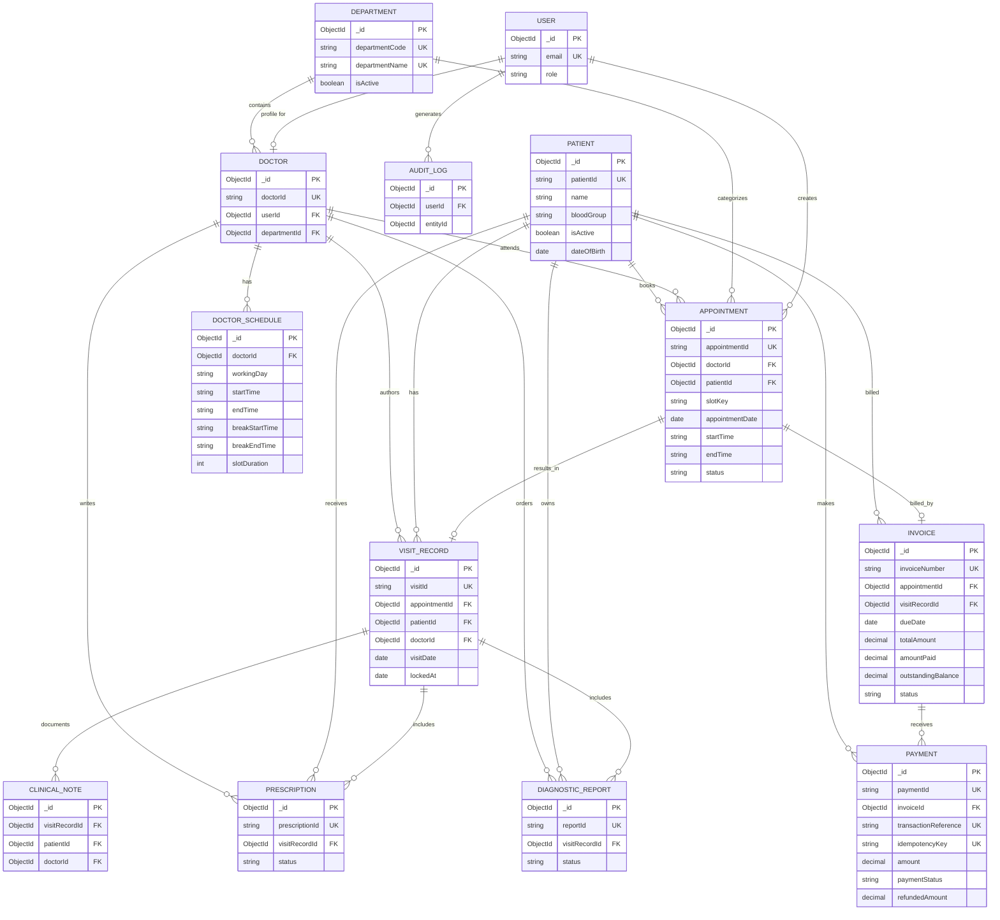

# Database ER Diagram

The schema uses MongoDB collections with Mongoose `ObjectId` references. References are kept explicit so records can be populated when needed without duplicating mutable patient or clinician data.

## Integrity decisions

- Business identifiers and user email have unique indexes.
- Search-oriented text/compound indexes cover patient and doctor lookup.
- Appointment queries are indexed by doctor, date, time, and status.
- Appointment creation in the implementation phase will normalize a requested appointment to a schedule slot and derive `slotKey` as `doctorId + date + startTime`. The partial unique index on active (`scheduled` or `confirmed`) appointments rejects concurrent duplicate inserts with MongoDB duplicate-key error `11000`. The booking service must translate that error to a conflict response.
- When a booking also updates related records, the service will use a MongoDB transaction with `session.withTransaction()`. Availability checks remain advisory; the unique index is the concurrency boundary.
- Invoice appointment and visit-record appointment references are unique to enforce one invoice and one visit record per appointment. Payments remain one-to-many to support retries and partial payments.
- Clinical records use public unique identifiers, author references, and optional `lockedAt` fields. Clinician access is checked through the doctor linked to the authenticated user and the appointment/visit patient relationship.
- Diagnostic reports currently store metadata only. File metadata is validated, but private file storage and authenticated download are intentionally deferred until secure object storage is configured.
- Invoice amounts are recalculated from line items on the backend. Payment and refund idempotency keys are unique, and invoice balance changes use conditional atomic updates when transactions are unavailable.
- Payment records are simulated only and contain no card, UPI PIN, password, or banking credential fields.
